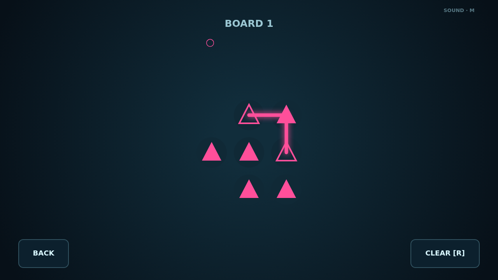

# Refract

Refract turns an optical bench into a drawing puzzle. Press an emitter and trace its light from node to node, threading every matching lens before reaching the channel's second emitter.

Every line matters. Beams can step diagonally, but they cannot cross, overlap, or touch another channel's optics. Crystals accept any color and ask you to spend every charge exactly, so one elegant route often unlocks another.

Campaign is a handcrafted climb through 24 boards, from compact single-color patterns to dense three-channel puzzles. Boards stay unlocked for replay as you work through four escalating sets.

Cascade keeps the light flowing with an endless run of generated boards. Solve five at a tier and the bench grows wider, busier, and more entangled.

